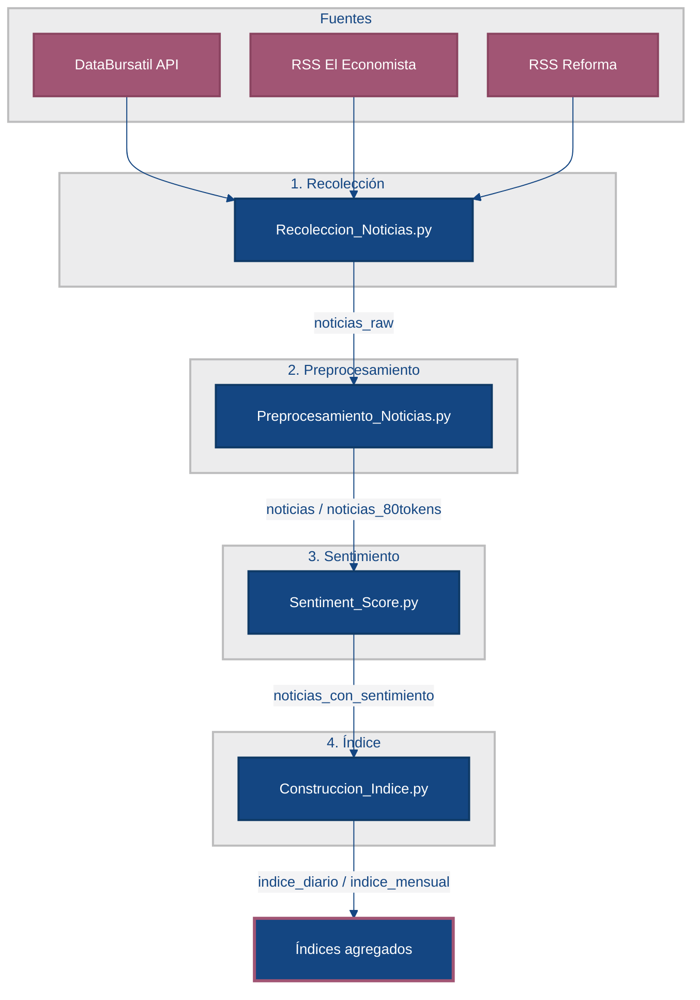

# Indicador de sentimiento en noticias económicas

Pipeline automatizado para **recolectar**, **filtrar**, **clasificar** y **agregar** noticias de medios mexicanos, con el fin de construir un **índice de sentimiento** derivado del tono financiero del texto. Los resultados se almacenan en **Google Sheets** y el proceso puede ejecutarse de forma programada con **GitHub Actions**.

---

## Resumen del flujo

El sistema consta de cuatro etapas secuenciales. Cada script lee y escribe hojas específicas en un mismo libro de Google Sheets.



| Etapa | Script | Frecuencia (Actions) | Hoja principal de salida |
|:-----:|--------|----------------------|--------------------------|
| 1 | `Recoleccion_Noticias.py` | Varias veces al día | `noticias_raw` |
| 2 | `Preprocesamiento_Noticias.py` | Domingos (+ manual) | `noticias`, `noticias_80tokens` |
| 3 | `Sentiment_Score.py` | Domingos (tras preproceso) | `noticias_con_sentimiento` |
| 4 | `Construccion_Indice.py` | Domingos (tras sentimiento) | `indice_diario`, `indice_mensual` |

---

## 1. Recolección de noticias

**Archivo:** `Recoleccion_Noticias.py`

Consolida noticias desde tres fuentes y las agrega al final de la hoja `noticias_raw`:

| Fuente | Origen | Criterio de filtrado |
|--------|--------|----------------------|
| **DataBursatil** | API REST (`api.databursatil.com`) | Regiones o entidades/indicadores mexicanos |
| **El Economista** | RSS de últimas noticias | Regiones/entidades **y** términos de economía |
| **Reforma** | RSS de negocios | Regiones o entidades/indicadores |

### Filtrado por diccionarios

Los textos se normalizan (minúsculas, sin acentos) y se buscan coincidencias de **palabras completas** o **frases** definidas en los archivos de la carpeta `Diccionarios/` (incluidos en la rama `main` del repositorio). Cada término va separado por comas dentro del archivo `.txt`.

| Archivo | Contenido | Usado en |
|---------|-----------|----------|
| `diccionario_regiones_mexico.txt` | Estados, ciudades y referencias geográficas | Las tres fuentes |
| `diccionario_entidades_indicadores_mexicanos.txt` | Instituciones e indicadores nacionales | Las tres fuentes |
| `diccionario_economia_actualizado.txt` | Vocabulario económico y financiero | El Economista (obligatorio) |

### Campos generados

| Columna | Descripción |
|---------|-------------|
| `fecha` | Fecha de publicación (RSS) o de recolección (API) |
| `fuente` | Dominio o medio |
| `titulo`, `descripcion`, `contenido` | Texto limpio (sin HTML) |
| `texto_input` | Concatenación para análisis posterior |
| `url` | Enlace a la nota |
| `fecha_recoleccion` | Marca temporal del proceso |
| `id_unico` | UUID por registro |

---

## 2. Preprocesamiento

**Archivo:** `Preprocesamiento_Noticias.py`

Lee `noticias_raw`, depura duplicados y normaliza el catálogo de noticias únicas.

### Deduplicación

Se eliminan filas repetidas, en este orden:

1. Misma `url`
2. Mismo `titulo`
3. Misma `descripcion`

### Hojas de salida

**`noticias`** — conjunto limpio con columnas:

`sentimiento`, `titulo`, `fecha`, `descripcion`, `url`, `id_unico`, `fuente`

La columna `fuente` se estandariza a: *Axis Negocios*, *El Economista*, *Reforma* u *Otro*.

**`noticias_80tokens`** — texto recortado para el modelo de sentimiento:

- Se concatena `titulo` + `descripcion`
- Se trunca a **80 tokens** con el tokenizador de `dccuchile/bert-base-spanish-wwm-cased`
- Incluye `n_tokens` para verificación

---

## 3. Puntuación de sentimiento

**Archivo:** `Sentiment_Score.py`

Clasifica el tono financiero de cada noticia usando el modelo **`bardsai/finance-sentiment-es-base`** (BERT en español orientado a finanzas).

### Etiquetas y scores

| Etiqueta del modelo | `sentimiento` | Interpretación |
|--------------------|---------------|----------------|
| `positive` | `+1` | Tono positivo |
| `neutral` | `0` | Tono neutro |
| `negative` | `-1` | Tono negativo |

Para cada noticia se calcula:

- **`confidence`** — probabilidad asignada por el modelo
- **`sentiment_score`** — `confidence × sentimiento` (valor continuo con signo)

Solo se etiquetan filas **nuevas** (por `id_unico`); las ya procesadas en `noticias_con_sentimiento` se conservan.

---

## 4. Construcción del índice

**Archivo:** `Construccion_Indice.py`

Agrega los `sentiment_score` en series temporales.

### Índice diario (`indice_diario`)

- Promedio diario de `sentiment_score`
- Número de noticias por día (`n_noticias`)
- Promedio diario de `confidence`
- Calendario **continuo**: los días sin noticias aparecen con valores vacíos y `n_noticias = 0`

### Índice mensual (`indice_mensual`)

- Promedio **ponderado** por volumen de noticias del mes
- Total de noticias, días con datos y confianza media ponderada

---

## Estructura del repositorio

```
Recoleccion-Noticias-Automatizada/
├── Recoleccion_Noticias.py      # Etapa 1: recolección
├── Preprocesamiento_Noticias.py # Etapa 2: limpieza y tokens
├── Sentiment_Score.py           # Etapa 3: clasificación
├── Construccion_Indice.py       # Etapa 4: agregación
├── Diccionarios/
│   ├── diccionario_regiones_mexico.txt
│   ├── diccionario_entidades_indicadores_mexicanos.txt
│   └── diccionario_economia_actualizado.txt
├── requirements.txt
├── .github/workflows/
│   ├── recolectar_noticias.yml  # Recolección programada
│   └── indice_diario.yml        # Preproceso + sentimiento + índice (domingos)
└── credentials.json             # No versionar (local o secret en Actions)
```

---

## Diccionarios

En `Diccionarios/` (rama `main`) están los tres listados de términos que usa `Recoleccion_Noticias.py` al filtrar noticias:

```
Diccionarios/
├── diccionario_regiones_mexico.txt
├── diccionario_entidades_indicadores_mexicanos.txt
└── diccionario_economia_actualizado.txt
```

**Formato:** un listado por archivo; términos separados por comas (p. ej. `méxico, cdmx, inflación, banxico`). El script normaliza acentos y mayúsculas antes de comparar.

**Criterios por fuente:**

- **DataBursatil y Reforma:** la noticia debe mencionar al menos un término de *regiones* **o** de *entidades/indicadores*.
- **El Economista:** debe cumplir lo anterior **y** incluir al menos un término de *economía* (si no aparece en título o descripción, se revisa un extracto del contenido).

Para ampliar la cobertura temática o geográfica, basta con editar estos archivos y volver a ejecutar la recolección.

---

## Requisitos

- **Python 3.12**
- Cuenta de **Google Cloud** con API de Sheets habilitada y archivo de credenciales de cuenta de servicio
- Token de **DataBursatil** (`DATABURSATIL_TOKEN`) para la API de noticias
- Acceso de edición al libro de Google Sheets configurado en los scripts

### Instalación

```bash
python -m venv .venv
source .venv/bin/activate   # Windows: .venv\Scripts\activate
pip install -r requirements.txt
```

Coloque `credentials.json` en la raíz del proyecto o defina:

```bash
export GOOGLE_APPLICATION_CREDENTIALS="/ruta/a/credentials.json"
export DATABURSATIL_TOKEN="su_token"
```

### Ejecución local (orden recomendado)

```bash
python Recoleccion_Noticias.py
python Preprocesamiento_Noticias.py
python Sentiment_Score.py
python Construccion_Indice.py
```

> La primera ejecución de preprocesamiento y sentimiento descargará los modelos de Hugging Face; puede tardar varios minutos.

---

## Automatización con GitHub Actions

| Workflow | Disparador | Scripts ejecutados |
|----------|------------|-------------------|
| `recolectar_noticias.yml` | Cron (varias horas, UTC) y manual | `Recoleccion_Noticias.py` |
| `indice_diario.yml` | Domingos (UTC) y manual | `Preprocesamiento_Noticias.py` → `Sentiment_Score.py` → `Construccion_Indice.py` |

### Secrets requeridos en el repositorio

| Secret | Uso |
|--------|-----|
| `GOOGLE_CREDENTIALS_JSON` | Contenido completo de `credentials.json` |
| `DATABURSATIL_TOKEN` | Token de la API DataBursatil |

---

## Dependencias principales

| Paquete | Rol en el pipeline |
|---------|-------------------|
| `requests`, `feedparser` | API y feeds RSS |
| `gspread`, `pandas` | Lectura/escritura en Google Sheets |
| `transformers`, `torch` | Tokenización y modelo de sentimiento |

`requirements.txt` instala **PyTorch CPU** (sin CUDA), adecuado para GitHub Actions.

---

## Notas de diseño

- **Relevancia temática:** la recolección descarta noticias que no mencionan términos de los diccionarios, enfocando el índice en economía y contexto mexicano.
- **Incrementalidad:** el etiquetado de sentimiento no reprocesa noticias ya clasificadas.
- **Consistencia del modelo:** el truncamiento a 80 tokens usa el mismo tokenizador BERT en español que acota la entrada al clasificador financiero.
- **Agregación:** el índice diario facilita series regulares; el mensual pondera por volumen para reflejar días con mayor cobertura informativa.

---

## Contexto del proyecto

Desarrollo en el marco del **índice de sentimiento derivado de noticias** (consultoría CIMAT / INEGI). El repositorio implementa la cadena operativa desde la fuente periodística hasta indicadores diarios y mensuales listos para análisis posterior.
